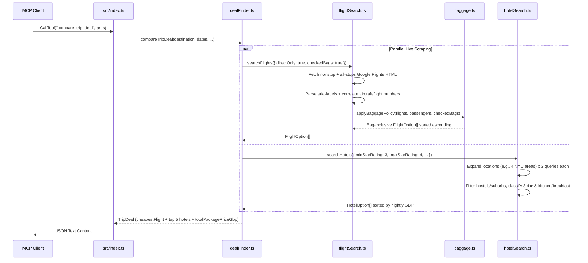

# `travel-mcp` — Technical Specification & Architecture Reference

**Package:** `travel-mcp` (`v1.0.0`)  
**Location:** `~/.gemini/antigravity/scratch/travel-mcp`  
**Entry Points:**
- **MCP Server (`stdio`):** `dist/index.js` (compiled from `src/index.ts`)
- **Voice & Terminal Agent CLI:** `dist/agent/cli.js` (compiled from `src/agent/cli.ts`)

---

## 1. System Overview

`travel-mcp` is a dual-mode TypeScript/Node.js (`ES2022` / `NodeNext` ESM) system providing zero-API-key live flight and hotel search, airline checked-baggage total cost modeling, multi-platform 1-click booking deep-link generation, and ITA Matrix advanced routing synthesis:

1. **Model Context Protocol (MCP) Server:** Exposes 6 lazy-loaded tools over `StdioServerTransport` (`@modelcontextprotocol/sdk` `^1.6.1`), registered globally in `~/.gemini/config/mcp_config.json` with cached tool schemas in `~/.gemini/antigravity/mcp/travel-mcp/`.
2. **Standalone Bidirectional Voice & Terminal Agent:** Interactive and one-shot CLI (`npm run agent`) using `@google/genai` (`^2.22.0`), native macOS `AVFoundation` microphone capture (`src/agent/record.swift` → `bin/macos-rec`), Gemini multimodal speech-to-text, and Microsoft Edge Neural TTS (`node-edge-tts`, `en-GB-RyanNeural`) played via `afplay`.

> [!NOTE]
> The MCP server performs live server-side rendered (SSR) HTML scraping against Google Travel (`google.com/travel/flights` and `google.com/travel/hotels`) using native Node.js `fetch` and regex extraction. It requires **no external API keys** when invoked as an MCP server; `GEMINI_API_KEY` / `GOOGLE_API_KEY` is only required when running the standalone `travel-agent` CLI.

---

## 2. Architecture & Execution Flow


### Package Aggregation Sequence (`compare_trip_deal`)



---

## 3. Repository Structure & Module Map

```text
~/.gemini/antigravity/scratch/travel-mcp/
├── package.json              # ESM package manifest, scripts, dependencies
├── tsconfig.json             # TypeScript config (ES2022, NodeNext, strict)
├── README.md                 # Quickstart & user guide
├── TECHNICAL.md              # Technical specification & architecture reference
├── bin/
│   └── macos-rec             # Compiled macOS binary of record.swift
├── dist/                     # Compiled JS + .d.ts declarations (active MCP target)
└── src/
    ├── index.ts              # MCP Server entry point & 6 tool handlers
    ├── types.ts              # Shared TypeScript interfaces & types
    ├── services/
    │   ├── flightSearch.ts   # Google Flights SSR scraper & segment correlator
    │   ├── baggage.ts        # Per-airline checked-bag fee rules & fare-family engine
    │   ├── hotelSearch.ts    # Google Hotels SSR scraper, brand/amenity heuristics
    │   ├── dealFinder.ts     # Trip package combiner & multi-city deal scanner
    │   ├── urlBuilder.ts     # Deep-link builders for 7 booking platforms
    │   └── itaMatrix.ts      # ITA Matrix routing/fare-basis/aircraft code generator
    └── agent/
        ├── index.ts          # Barrel exports for programmatic agent usage
        ├── cli.ts            # Interactive voice/REPL & one-shot CLI runner
        ├── travelAgent.ts    # GoogleGenAI chat wrapper with 429/503 model failover
        ├── tools.ts          # @google/genai FunctionDeclarations & future-date guard
        ├── prompts.ts        # Dynamic temporal system prompt generator
        ├── voice.ts          # EdgeTTS/afplay output & recorder/Gemini STT bridge
        └── record.swift      # Native AVAudioRecorder 16kHz mono AAC capture
```

| Module | Key Exports | Responsibility |
| :--- | :--- | :--- |
| `src/index.ts` | `Server` (`stdio`) | Registers `ListToolsRequestSchema` and `CallToolRequestSchema` for all 6 MCP tools. |
| `src/types.ts` | `FlightSearchParams`, `FlightOption`, `BaggageInfo`, `HotelSearchParams`, `HotelOption`, `TripDeal`, `ITAMatrixCommand` | Canonical data contracts across MCP handlers, scrapers, and CLI agent. |
| `src/services/flightSearch.ts` | `searchFlights` | Scrapes Google Flights SSR HTML, correlates equipment/flight numbers, filters routing/aircraft/duration, attaches booking links & baggage policy. |
| `src/services/baggage.ts` | `applyBaggagePolicy`, `estimateCheckedBagCost`, `parseDurationHours` | Models short-haul vs. long-haul return checked-bag fees across 18 airline groups and re-ranks flights by bag-inclusive price. |
| `src/services/hotelSearch.ts` | `searchHotels`, `calculateNights` | Scrapes Google Hotels SSR HTML across target neighborhoods, filters hostels/highway suburbs, infers 3–4★ ratings and kitchen/breakfast amenities. |
| `src/services/dealFinder.ts` | `compareTripDeal`, `findCheapestDestinations` | Combines cheapest flight + top 5 hotels into a package deal; scans 12 default European cities concurrently for lowest airfare. |
| `src/services/urlBuilder.ts` | `buildAllBookingLinks` + 7 platform builders | Formats dates (`YYMMDD`, `DD/MM/YYYY`, `YYYY-MM-DD`) and query parameters into pre-filtered checkout links. |
| `src/services/itaMatrix.ts` | `generateITAMatrixCommand` | Generates ITA Matrix routing codes (`N:`, `alliance`, `/ f bc=...`, `/ aircraft t:...`) and `maxconnect 0` extension codes. |

---

## 4. MCP Tool Reference

All tools return an MCP `CallToolResult` containing a single `text` block with pretty-printed JSON (`JSON.stringify(..., null, 2)`). On unhandled exceptions, the handler returns `{ isError: true, content: [{ type: 'text', text: 'Error executing tool ...' }] }`.

### 4.1 `search_flights`

| Parameter | Type | Required | Default | Description |
| :--- | :--- | :---: | :---: | :--- |
| `destination` | `string` | Yes | — | Destination city or IATA code (e.g., `"Barcelona"`, `"JFK"`). |
| `departureDate` | `string` | Yes | — | Outbound date (`YYYY-MM-DD`). |
| `returnDate` | `string` | Yes | — | Inbound date (`YYYY-MM-DD`). |
| `origin` | `string` | No | `"LON"` | Origin city or IATA code (`"LON"` expands to `"London"` in Google Flights queries, covering `LHR`, `LGW`, `STN`, `LTN`, `LCY`). |
| `passengers` | `number` | No | `2` | Adult passenger count. |
| `directOnly` | `boolean` | No | `true` | Restrict results to direct non-stop flights. |
| `checkedBags` | `boolean` | No | `true` | Add 1 checked bag (~23kg) per passenger return to `totalPriceGbp` and sort by bag-inclusive total. |
| `currency` | `string` | No | `"GBP"` | Currency code. |
| `cabinClass` | `string` | No | `"economy"` | Enum: `"economy"` \| `"premium_economy"` \| `"business"` \| `"first"`. |
| `aircraftFilter` | `string[]` | No | `undefined` | Case-insensitive substring filter against detected equipment (e.g., `["A350", "A380", "777", "787"]`). |
| `minDurationHours` | `number` | No | `undefined` | Minimum flight duration in hours (e.g., `8` for long-haul `8h+`). |

### 4.2 `search_hotels`

| Parameter | Type | Required | Default | Description |
| :--- | :--- | :---: | :---: | :--- |
| `destination` | `string` | Yes | — | Destination city or district. |
| `checkinDate` | `string` | Yes | — | Check-in date (`YYYY-MM-DD`). |
| `checkoutDate` | `string` | Yes | — | Check-out date (`YYYY-MM-DD`). |
| `adults` | `number` | No | `2` | Number of adult guests. |
| `rooms` | `number` | No | `1` | Number of rooms. |
| `minStarRating` | `number` | No | `3` | Minimum inferred star rating. |
| `maxStarRating` | `number` | No | `4` | Maximum inferred star rating. |
| `requireKitchenOrBreakfast` | `boolean` | No | `true` | Require kitchen/kitchenette or breakfast amenity. |
| `preferredLocations` | `string[]` | No | NYC auto-list | Explicit neighborhoods to query. Defaults to `["Jersey City", "Journal Square", "Long Island City", "Manhattan"]` when destination matches NYC terms. |
| `minRating` | `number` | No | `undefined` | Minimum Google user review score out of `5.0` (e.g., `4.0`). |
| `maxPricePerNight` | `number` | No | `undefined` | Nightly price cap in GBP. |
| `currency` | `string` | No | `"GBP"` | Currency code. |

### 4.3 `compare_trip_deal`
- Executes `searchFlights` (`directOnly: true`) and `searchHotels` concurrently via `Promise.all`.
- Computes `totalPackagePriceGbp = cheapestFlight.totalPriceGbp + topHotels[0].totalPriceGbp` (or flight-only if `hotels` is empty; returns `{ error: ... }` if no direct flights are found).
- Returns `TripDeal` containing `cheapestFlight`, up to 5 `recommendedHotels`, total & per-person GBP prices, and 7 platform booking URLs.

### 4.4 `find_cheapest_destinations`
- Concurrently runs `searchFlights` across `destinations` (defaults to 12 cities in `DEFAULT_POPULAR_DESTINATIONS`: `Barcelona`, `Rome`, `Amsterdam`, `Dublin`, `Madrid`, `Paris`, `Lisbon`, `Milan`, `Prague`, `Berlin`, `Venice`, `Faro`).
- Returns `DestinationDeal[]` sorted ascending by `totalFlightPriceGbp` (bag-inclusive by default).

### 4.5 `generate_booking_links`
- Synchronous URL generator returning `MultiPlatformBookingLinks` (`flights`: Skyscanner, Expedia, Google Flights, ITA Matrix, BookWithMatrix; `hotels`: Booking.com, Hotels.com, Expedia, Google Hotels).

### 4.6 `ita_matrix_power_search`
- Accepts `destination`, `departureDate`, `returnDate`, `origin` (`"LON"`), `passengers` (`2`), `currency` (`"GBP"`), optional `alliance` (`"star-alliance"` \| `"oneworld"` \| `"skyteam"`), `cabinClass`, and `aircraftFilter`.
- Synthesizes ITA Matrix routing & extension codes plus step-by-step BookWithMatrix instructions.

---

## 5. Scraping, Pricing & Heuristic Engines

### 5.1 Google Flights SSR Scraper (`src/services/flightSearch.ts`)
1. **Query Construction (`buildQueryUrl`):**
   Builds natural-language Google Flights URLs:
   `https://www.google.com/travel/flights?q=<encoded>&curr=GBP&hl=en-GB`
   where `<encoded>` is `"[<cabinClass> flights to | Flights to ]<destination> from <originQuery> on <departureDate> through <returnDate> <passengers> adults [nonstop]"`.
2. **Dual-Fetch Coverage:** When `directOnly === true`, `searchFlights` fetches **both** the `nonstop` query URL and the unrestricted query URL via `Promise.allSettled`, then filters for `f.isDirect` in memory to maximize SSR recall.
3. **Dual-Pass HTML Extraction (`fetchAndParse`):**
   - **Pass 1 — Equipment & Flight Number Extraction (`extractFlightSegments`):** Scans inline serialized protobuf/JSON arrays in Google's `<script>` payload matching aircraft name, 2-char carrier code, flight number, airline name, origin/dest 3-letter IATA codes, `[hour, min]` tuples, and segment minutes.
   - **Pass 2 — Accessibility Label Fare Extraction:** Matches `aria-label="From ([\d,]+) British pounds round trip total\..*?Select flight"` to extract round-trip total GBP price, airline, origin/destination airport names, departure/arrival times, total duration, and non-stop status (`non-stop` / `nonstop`).
   - **Segment Correlation:** Joins each `aria-label` flight summary with Pass 1 segments by exact `depTime` or case-insensitive `airline` substring match.
4. **Deduplication:** Deduplicates by key `${airline}-${departureTime}-${isDirect}`, retaining the lowest `rawPrice`.

### 5.2 Checked-Baggage Cost Engine (`src/services/baggage.ts`)
Because Google Flights SSR displays unbundled basic-economy / hand-luggage fares, `applyBaggagePolicy` adjusts pricing according to three modes:
- **Premium Cabins (`business` or `first`):** Adds `£0` bag cost (`isEstimate: false`), annotating `2 x 32kg` bags per passenger included in the fare.
- **Hand-Luggage Mode (`checkedBags: false`):** Preserves `baseFareTotalGbp` with `estimatedBagCostTotalGbp: 0`.
- **Default Bag-Inclusive Mode (`checkedBags: true`):** Classifies flights with `parseDurationHours(duration) >= 6` (`LONG_HAUL_MIN_HOURS`) as **long-haul** and `< 6h` as **short-haul**, adds `perPerson * passengers` to `baseFareTotalGbp`, and **re-sorts** all options ascending by the new `totalPriceGbp`.

| Airline Pattern (`AIRLINE_BAG_RULES`) | Short-Haul (`<6h`) | Long-Haul (`>=6h`) | Recommended Fare Family / Add-On |
| :--- | :---: | :---: | :--- |
| Virgin Atlantic (`/virgin/i`) | £70 | £120 | Economy Classic (1 x 23kg included) |
| Delta (`/delta/i`) | £70 | £120 | Main Cabin (1 x 23kg included on transatlantic) |
| British Airways (`/british airways/i`) | £50 | £120 | Economy Standard / Euro Traveller with bag (1 x 23kg) |
| American Airlines (`/american/i`) | £70 | £120 | Main Cabin (1 x 23kg included on transatlantic) |
| United (`/united/i`) | £70 | £120 | Standard Economy (1 x 23kg included on transatlantic) |
| JetBlue (`/jetblue/i`) | £100 | £110 | Blue Plus (1 checked bag included) |
| Aer Lingus (`/aer lingus/i`) | £60 | £110 | Smart / Plus fare (1 x 23kg) |
| Norse Atlantic (`/norse/i`) | £90 | £90 | Economy Classic (1 x 23kg) |
| easyJet (`/easyjet/i`) | £90 | £90 | Add 23kg hold bag per person, both directions |
| Ryanair (`/ryanair/i`) | £85 | £85 | Add 20kg check-in bag per person, both directions |
| Wizz Air (`/wizz/i`) | £85 | £85 | Add 20kg/32kg checked bag per person, both directions |
| Jet2 (`/jet2/i`) | £70 | £70 | Add 22kg hold bag per person, both directions |
| Vueling (`/vueling/i`) | £60 | £60 | Optima fare or add 23kg bag |
| TAP Air Portugal (`/\btap\b\|tap air/i`) | £60 | £120 | Classic fare (1 x 23kg) |
| Iberia (`/iberia/i`) | £60 | £120 | Standard / Comfort fare (1 x 23kg) |
| Lufthansa Group (`/lufthansa\|swiss\|austrian\|brussels/i`) | £60 | £120 | Classic fare (1 x 23kg) |
| Air France / KLM (`/klm\|air france/i`) | £60 | £120 | Standard fare (1 x 23kg) |
| ITA Airways (`/ita airways/i`) | £60 | £120 | Classic fare (1 x 23kg) |
| **Fallback Default** (unmatched carrier) | **£75** | **£120** | Cheapest fare that includes 1 checked bag per person |

*(All figures above are GBP **per passenger, round-trip**.)*

### 5.3 Google Hotels Scraper & Brand Heuristics (`src/services/hotelSearch.ts`)
- **NYC Neighborhood Auto-Expansion:** If `destination` matches `new york`, `nyc`, `jfk`, `ewr`, `jersey city`, `manhattan`, or `long island city` and `preferredLocations` is omitted, searches expand across `['Jersey City', 'Journal Square', 'Long Island City', 'Manhattan']` while disqualifying highway suburbs (`north bergen`, `secaucus`, `fort lee`, `bronx`).
- **Anti-Inflation Dual Query:** For each location, runs both `"hotels in <loc> from <in> to <out>"` and `"3 or 4 star hotels with kitchen or breakfast in <loc> from <in> to <out>"`, merging amenities by hotel name and keeping the **lower** nightly GBP rate (`aria-label="Prices starting from £([\d,]+), ([^"]+)"`).
- **Quality & Amenity Classification:**
  - **Disqualified Properties (`isDisqualifiedBudgetOrHostel`):** Rejects names matching `ymca`, `hostel`, `eurohostel`, `rodeway`, `motel 6`, `days inn`, `travelodge`, `econo lodge`, `super 8`, `haiban`, `bowery`, `q4 hotel`, `the local ny`, `voyage hotel`, `shefah`, `canal loft`.
  - **Star Inference (`detectStarRating`):** Assigns `4★` to `Hyatt Regency`, `DoubleTree`, `Canopy`, `Aloft`, `Crowne Plaza`, `Westin`, `Marriott`, and full-service `Hilton` (excluding `Hampton` and `Garden Inn`); assigns `3★` otherwise.
  - **Amenity Inference (`detectAmenities`):** Flags `"Kitchen / Kitchenette"` (`suites`, `residence inn`, `homewood`, `home2`, `towneplace`, `sonesta simply`, `candlewood`, `staybridge`, `apart`, `kitchen`, `sonder`, `hyatt house`) and `"Breakfast included"` (`holiday inn express`, `hampton`, `hyatt house`, `hyatt place`, `fairfield`, `residence inn`, `homewood`, `home2`, `towneplace`, `springhill`, `comfort inn`, `quality suites`, `ramada`, `wingate`, `breakfast`), falling back to `"Kitchen or Breakfast available"`.

### 5.4 Deep-Link Formats & ITA Matrix Codes (`src/services/urlBuilder.ts`, `src/services/itaMatrix.ts`)
- **Skyscanner:** `https://www.skyscanner.net/transport/flights/{orig}/{dest}/{YYMMDD_out}/{YYMMDD_in}/?adultsv2={pax}&cabinclass={cabin}&rtn=1&preferdirects={bool}&currency={curr}`
- **Kayak (IATA-only, Bag-Fee Filter):** Built only when `origin` and `destination` match `/^[A-Z]{3}$/`. Appends `&fs=stops=0;bfc=1;cabin={e|p|b|f}` so Kayak displays bag-inclusive fares.
- **Expedia UK Flights:** Uses `DD/MM/YYYYTANYT` leg timestamps and `options=cabinclass:{cabin},nstop:1`.
- **Booking.com / Hotels.com UK / Expedia UK Hotels / Google Hotels:** Pre-populates `YYYY-MM-DD` check-in/out dates, adult count, room count, and `GBP` currency.
- **ITA Matrix Routing Codes:**
  - Base direct code: `N:` (or `alliance star-alliance|oneworld|skyteam`), Extension: `maxconnect 0`.
  - Fare basis classes: Business `/ f bc=J|bc=C|bc=D|bc=I|bc=R`, First `/ f bc=F|bc=A`, Premium Economy `/ f bc=W|bc=E|bc=T`.
  - Aircraft equipment translation: `350` → `t:359 t:351`, `380` → `t:388`, `777` → `t:77W t:772 t:773 t:77L`, `787` → `t:788 t:789 t:78X t:781`.

---

## 6. Standalone Voice & CLI Agent Architecture

Located under `src/agent/`:
- **LLM Orchestration (`TravelAgent`):**
  - Default model: `process.env.TRAVEL_AGENT_MODEL || 'gemini-3.6-flash'` (`temperature: 0.2`, `MAX_TOOL_LOOPS = 5`).
  - Loads `.env` from CWD, package root, and `~/.gemini/antigravity/scratch/.env` (`GEMINI_API_KEY` or `GOOGLE_API_KEY`).
  - **Multi-Model Resilient Failover (`sendWithRetry`):** Intercepts HTTP `429` (`RESOURCE_EXHAUSTED`), `500`, and `503` (`UNAVAILABLE`), parses server `retryDelay` hints, migrates existing chat history to a backup model (`['gemini-3.6-flash', 'gemini-3.1-flash-lite', 'gemini-flash-latest']`), and retries up to 3 times.
- **Temporal Guardrails:**
  - `getTravelAgentSystemPrompt()` injects the live ISO date at session startup.
  - `ensureFutureDate()` automatically rolls forward any tool call date whose year or month/day lies in the past.
- **Bidirectional Audio (`src/agent/voice.ts`, `src/agent/record.swift`):**
  - **Capture:** Spawns compiled `bin/macos-rec` (or `/usr/bin/swift src/agent/record.swift`), recording `16kHz` mono MPEG-4 AAC to `/tmp/travel_user_voice.m4a` until newline on `stdin` or a 30s timeout.
  - **Transcription:** Base64-encodes `.m4a` payloads (`>= 2000` bytes) to `gemini-3.6-flash` (`mimeType: 'audio/m4a'`).
  - **Speech Synthesis:** Summarizes full Markdown tables into 2–3 spoken sentences via `gemini-3.6-flash`, renders MP3 to `/tmp/travel_speech.mp3` via `EdgeTTS` (`en-GB-RyanNeural`, `rate: '+5%'`), plays via `/usr/bin/afplay`, and falls back to macOS `/usr/bin/say -v Daniel` offline.

---

## 7. Configuration, Build & Operations

### Antigravity MCP Registration (`~/.gemini/config/mcp_config.json`)
```json
{
  "mcpServers": {
    "travel-mcp": {
      "command": "node",
      "args": [
        "/path/to/travel-mcp/dist/index.js"
      ]
    }
  }
}
```

### NPM Scripts (`package.json`)
| Script | Command | Purpose |
| :--- | :--- | :--- |
| `npm run build` | `tsc` | Compiles `src/**/*.ts` → `dist/` (must be run after editing `src/` for MCP changes to take effect). |
| `npm start` | `node dist/index.js` | Launches compiled MCP server on `stdio`. |
| `npm run dev` | `tsx src/index.ts` | Runs TypeScript MCP server directly in dev mode. |
| `npm run agent` | `tsx src/agent/cli.ts` | Starts interactive bidirectional Voice & Terminal Travel Agent (`-- "prompt" --voice` for one-shot). |
| `npm run agent:dist` | `node dist/agent/cli.js` | Runs compiled standalone CLI agent. |

---

## 8. Known Technical Caveats & Maintenance Notes

1. **GBP Locale Coupling in SSR Parsers:** Both `flightSearch.ts` (`From [\d,]+ British pounds`) and `hotelSearch.ts` (`Prices starting from £[\d,]+`) match British Pound text/symbols in Google's `en-GB` `aria-label` attributes. Passing a non-`GBP` `currency` parameter alters Google's rendered labels and will return `0` parsed results unless the regexes are generalized.
2. **CLI Agent vs. MCP Schema Drift (`src/agent/tools.ts`):**
   - Newer MCP parameters added to `src/index.ts` (`checkedBags`, `cabinClass`, `aircraftFilter`, `minDurationHours` on `search_flights`; `alliance`, `cabinClass`, `aircraftFilter` on `ita_matrix_power_search`) are not yet exposed in the standalone CLI agent's `travelToolDeclarations`.
   - Positional argument bug in standalone CLI adapter: `executeTravelTool` (`src/agent/tools.ts` line 348) calls `generateITAMatrixCommand(args.origin || 'LON', args.destination, depDate!, retDate!, ...)`, whereas `generateITAMatrixCommand` expects `(destination, departureDate, returnDate, origin, ...)`. (The MCP server in `src/index.ts` passes arguments in the **correct** order.)
3. **Heuristic Hotel Amenity Fallback:** In `detectAmenities`, hotels whose names do not match known suite/breakfast brand keywords receive the fallback tag `"Kitchen or Breakfast available"`, meaning `requireKitchenOrBreakfast` relies primarily on the targeted Google Hotels search query and brand-disqualification list rather than per-property DOM inspection.
4. **Unused Dependencies:** `cheerio` (`^1.0.0`) and `zod` (`^3.24.2`) are listed in `package.json`, though all current HTML extraction and MCP input schemas use native RegExp and raw JSON Schema objects respectively.
